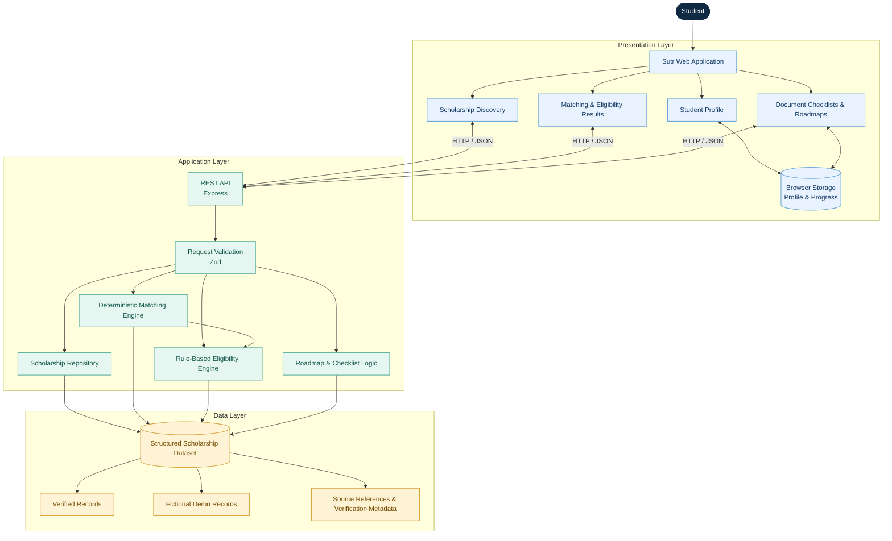

<div align="center">

# Sutr

### Scholarship discovery, made simpler.

**Find opportunities. Understand eligibility. Plan your next step.**

Sutr is a student-focused platform that brings scholarship discovery, rule-based eligibility checking, document preparation, and application planning into one organised workflow.

[Live Demo](https://gokul-555180.github.io/Sutr-2.0/) · [GitHub Repository](https://github.com/Gokul-555180/Sutr-2.0)

</div>

---

## The Problem

In India, scholarship information is scattered across government portals, state-specific websites, college announcements, and individual scholarship pages. Students often have to search through multiple sources just to find opportunities relevant to their course, academic performance, family income, and eligibility requirements.

The bigger problem is that **finding information is only half the battle**. Understanding eligibility, identifying required documents, checking deadlines, and keeping track of application steps can be confusing. Incomplete or outdated information makes the process even harder.

As a result, students may miss financial assistance simply because discovering and managing the right opportunities takes too much effort.

## What is Sutr?

Sutr aims to simplify this process by bringing scholarship discovery and application preparation into a single platform.

Students can explore scholarship opportunities, evaluate their eligibility using a rule-based matching system, understand which criteria they meet, and organise their application preparation through document checklists and roadmaps.

**No AI. No unnecessary complexity. Just structured information and transparent eligibility logic.**

The current version uses deterministic application logic rather than AI-generated decisions. Scholarship data is clearly distinguished between verified records and fictional demonstration records.

## Key Features

* **Scholarship Discovery:** Search and filter scholarship opportunities based on available information.
* **Profile-Based Matching:** Compare student details against the eligibility criteria represented in scholarship records.
* **Rule-Based Eligibility:** Identify satisfied, unsatisfied, and unknown conditions through deterministic logic.
* **Scholarship Details:** View available eligibility requirements, award information, deadlines, documents, and source references.
* **Document Checklists:** Organise the documents needed for application preparation.
* **Application Roadmaps:** Break the preparation process into manageable steps.
* **Progress Tracking:** Keep track of saved opportunities and preparation progress where implemented.
* **Data Transparency:** Distinguish verified information from fictional demonstration records.

*The availability of individual features depends on the current implementation. See the running application for the latest functionality.*

## How It Works

1. **Discover** — Explore available scholarship opportunities.
2. **Build Your Profile** — Enter the information needed to evaluate relevant eligibility criteria.
3. **Check Eligibility** — Sutr compares your profile against documented scholarship requirements.
4. **Understand the Result** — Review the conditions you meet, those you do not meet, and the information still missing.
5. **Prepare Your Application** — Use document checklists and application roadmaps to organise the next steps.
6. **Track Your Progress** — Resume your preparation later where progress persistence is implemented.

Eligibility results are preliminary guidance, not official approval. Students must always confirm the current requirements with the scholarship provider.

---

## System Architecture

Sutr separates the frontend, backend API, scholarship data, and eligibility engine. This keeps the core matching process explainable and independent of external AI services.



### Architecture Principles

* **Deterministic eligibility:** Explicit rules determine eligibility statuses.
* **Explainable results:** Students can understand why a criterion passed, failed, or remains unknown.
* **Separation of concerns:** The frontend, API, data repository, and business logic have distinct responsibilities.
* **Data transparency:** Verified and demo records are distinguishable.
* **Graceful handling of uncertainty:** Missing information is never automatically treated as proof of eligibility.

## Technology Stack

| Technology           | Purpose                                                   |
| -------------------- | --------------------------------------------------------- |
| React                | Interactive frontend                                      |
| Vite                 | Development tooling and production builds                 |
| TypeScript           | Type safety and maintainable application logic            |
| Lucide React         | Interface icons                                           |
| Node.js              | Backend runtime                                           |
| Express.js           | REST API                                                  |
| Zod                  | Request validation and schema enforcement                 |
| JSON / TypeScript    | Structured local scholarship data                         |
| Browser localStorage | Local profile and progress persistence, where implemented |

The current non-AI version does not require an AI provider, model inference service, or AI API key.

---

## Scholarship Data and Reliability

A scholarship platform is only as useful as the information it provides. Incorrect eligibility criteria or outdated deadlines can mislead students, so data quality is a core consideration in Sutr.

The platform distinguishes between:

* **Verified Records:** Information supported by an authoritative source. Verification should apply only to the specific details that have actually been checked.
* **Demo Records:** Fictional records used to demonstrate discovery, matching, and application workflows. These are not real scholarship opportunities.
* **Unknown Information:** Details that cannot be confirmed are treated as unknown rather than guessed.

Potential authoritative sources for scholarship research include:

* [National Scholarship Portal](https://scholarships.gov.in/)
* [Kerala e-Grantz](https://www.egrantz.kerala.gov.in/)
* [Kerala Higher Education Department](https://highereducation.kerala.gov.in/)

A source link alone does not prove that every detail in a record is current or verified. Students should confirm eligibility, deadlines, required documents, and application instructions through the official provider before applying.

## Understanding Eligibility Results

Sutr uses three overall eligibility statuses:

| Status                   | Meaning                                                                                         |
| ------------------------ | ----------------------------------------------------------------------------------------------- |
| `likely_eligible`        | All applicable mandatory criteria represented in the record are documented and satisfied.       |
| `needs_more_information` | No known mandatory criterion has failed, but one or more mandatory requirements remain unknown. |
| `likely_not_eligible`    | At least one documented mandatory criterion is not satisfied.                                   |

Each criterion can be evaluated as satisfied, not satisfied, unknown, or not applicable.

This prevents missing information from being silently treated as a successful match.

**Important:** These results are preliminary assessments based on the available data. They do not guarantee scholarship selection or replace official verification.

---

## Getting Started

### Prerequisites

* Node.js — preferably a current LTS version
* npm
* Git

### Clone the Repository

Replace the placeholders with your actual GitHub username and repository name.

```bash
git clone YOUR_GITHUB_REPOSITORY_URL
cd YOUR_REPOSITORY_NAME
```

### Install Dependencies

Check the repository's `package.json` files for the exact installation instructions.

If the frontend and backend are separate packages without npm workspaces:

```bash
cd backend
npm install

cd ../frontend
npm install
```

### Run the Application

Open two terminals from the project directory.

**Terminal 1 — Backend**

```bash
cd backend
npm run dev
```

**Terminal 2 — Frontend**

```bash
cd frontend
npm run dev
```

The exact scripts and ports depend on the current project configuration. Refer to the relevant `package.json` files and environment examples if the commands differ.

---

## Live Demo

**Live Application:** [Live Application](https://gokul-555180.github.io/Sutr-2.0/)

**GitHub Repository:** [View Source Code](https://github.com/Gokul-555180/Sutr-2.0)

Replace these placeholders before submitting the project. If the application has not been deployed yet, remove the live-demo link until it is available.

---

## Future Scope

Sutr is designed as a foundation that can grow into a more comprehensive scholarship discovery and application support platform.

The following are planned improvements, not claims about features already implemented.

### 1. A Larger and More Reliable Scholarship Catalogue

Expand coverage across central government schemes, state government programmes, universities, colleges, foundations, and private scholarship providers.

Each record could include source references, field-level verification information, update history, and application-cycle status.

### 2. Scholarship Data Maintenance

Introduce a structured review process to identify outdated records, verify eligibility changes, and track application deadlines.

Where available, official APIs and permitted data feeds could help keep information current. Any automated collection process should respect source terms and include appropriate verification.

### 3. More Advanced Eligibility Rules

Support more complex requirements, including renewal conditions, course-specific exceptions, institution restrictions, multiple academic systems, and additional documented criteria.

A comprehensive rule test suite would help maintain correctness as the dataset grows.

### 4. Better Scholarship Matching

Improve ranking using transparent factors such as academic level, course, state, and documented eligibility.

Each result should explain why it appears, while allowing students to explore other opportunities rather than hiding potentially relevant options.

### 5. Deadline Tracking and Reminders

Introduce reminders for verified application deadlines, renewal windows, and preparation tasks.

Notifications should be based on maintained information and clearly indicate when a deadline still needs confirmation.

### 6. Malayalam and Other Indian Languages

Expand accessibility through Malayalam and other Indian-language interfaces, making scholarship information easier to understand for more students.

Official scheme names and source references should remain accessible to reduce confusion.

### 7. Secure Accounts and Cross-Device Synchronisation

Introduce authentication and server-side persistence when the product requires them.

Students could securely access their saved scholarships and application progress across devices, with controls to export or delete their information.

### 8. Improved Document Preparation

Provide downloadable checklists, clearer preparation instructions, and tools to track document readiness.

Any future document upload feature would require explicit consent, secure handling, data minimisation, and a clear retention policy.

### 9. Optional AI Assistance in the Future

A future version could explore AI for plain-language explanations, multilingual guidance, or summaries of official scholarship instructions.

Such assistance would need to be grounded in verified sources and clearly separated from the deterministic eligibility engine. It must never invent scholarship rules, alter eligibility results, or guarantee funding.

**The current version of Sutr does not use AI.**

### 10. Transparency and Impact Measurement

Introduce data freshness indicators and privacy-conscious metrics to understand which features students use and where they encounter difficulties.

This could help prioritise improvements while avoiding unnecessary collection of personal information.

---

## Current Limitations

* Scholarship coverage depends on the records available in the current dataset.
* Fictional demo records are not real funding opportunities.
* Scholarship criteria and deadlines may change.
* Eligibility results cover only the criteria represented in the available data.
* Local browser storage, where used, may not synchronise across devices.
* Sutr does not submit scholarship applications automatically.
* Eligibility results do not guarantee scholarship awards.
* The current version does not use AI.

## Why Sutr?

Students should spend less time piecing together information from different websites and more time understanding the opportunities available to them.

Sutr brings scholarship information, transparent eligibility checks, and application preparation into one organised workflow.

The goal is simple: **make scholarship opportunities easier to discover, understand, and act on.**

## Contributing

Contributions that improve scholarship data quality, eligibility correctness, accessibility, testing, documentation, or the student experience are welcome.

When adding or updating scholarship records:

* Include authoritative sources.
* Distinguish confirmed information from unknown details.
* Avoid inventing deadlines, eligibility rules, or award amounts.
* Never present fictional demo records as real scholarship opportunities.

## Disclaimer

Sutr is an independent student-support project. It is not an official government portal and is not affiliated with any scholarship provider unless explicitly stated.

Scholarship information and eligibility results are provided for guidance only. Students should verify current requirements and application status with the official provider before applying.

---

<div align="center">

### Sutr

**Making scholarship opportunities easier to find and act on.**

Built with a focus on clarity, transparency, and practical student needs.

</div>
